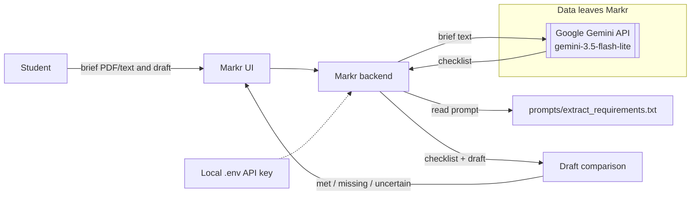

# Architecture sketch (M2)

- The model and API key are configured in the local `.env`; only `.env.example` is committed. The key must never be committed.
- The extraction prompt is versioned in `prompts/`.
- Assignment brief text (and, for the draft-checking feature, draft text) is sent to Google Gemini. The student reviews and can edit the extracted checklist before relying on it.
- This is the proposed M2 architecture, not a claim that the complete UI/product already exists. The M3 diagram must be updated to match the running implementation and identify every API/model version, data store and trust boundary.
