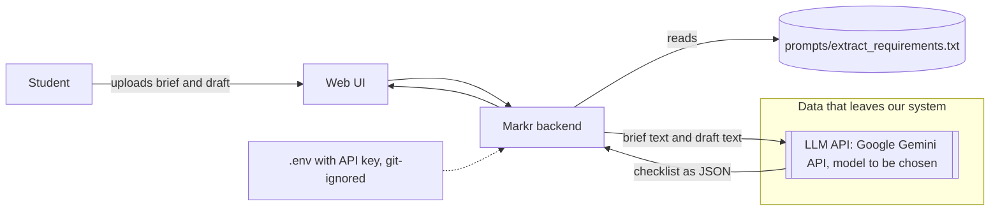

# Architecture sketch (M2, first version)

- Prompts live in `prompts/`; model names and the API key come from `.env` (never committed).
- Brief and draft text are sent to the API provider; nothing is stored by Markr in this first version.
- This is the M2 sketch. The final package needs a diagram exported as PNG or SVG that names every external API and model with its version.
