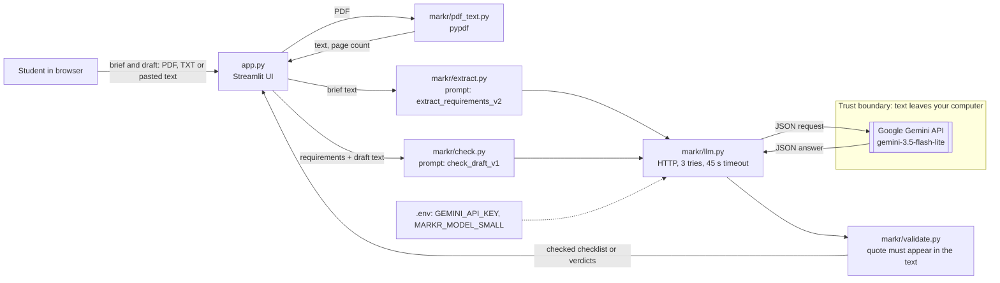

# Architecture (M3, running product)

- **Model:** `gemini-3.5-flash-lite` through the Gemini `generateContent` endpoint, temperature 0, JSON output. The name is read from `.env`.
- **Data stores:** none. The checklist and results live in the Streamlit session (memory) and disappear when the page is reloaded.
- **Trust boundary:** the brief text and, for the check, the draft text are sent to Google. Nothing else leaves the machine. The API key stays in the local `.env`, which is not committed.
- **Code checks around the AI:** a requirement is dropped when its `source_quote` is not found in the brief; a "met" becomes "uncertain" when its evidence is not found in the draft; word and page counts are computed by code.
- **Failure handling:** retries on 429/5xx/timeouts, then a message on screen.